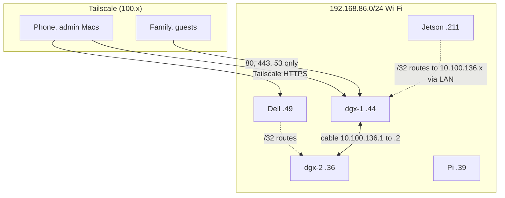

The fleet uses three networks:

| Network | Range | Carries |
|---|---|---|
| Home LAN (Nest Wifi Pro, Wi-Fi only today) | 192.168.86.0/24 | Almost everything: Ansible, web routes from the front door to backends, OTLP, NATS, Zenoh, k3s traffic to the Jetson and the Dell |
| Tailscale tailnet `tail1cb707.ts.net` | 100.64.0.0/10 | Phones and admin devices, family and guests (front door only), split DNS for `nghodki.ai`, ntfy push to the phone |
| Spark cable 1 (200 Gb/s QSFP) | 10.100.136.0/24 | k3s API, etcd peers and flannel between dgx-1 and dgx-2 |
| Spark cable 2 | 10.100.137.0/24 | RDMA/NCCL for models split across both Sparks; not used by k3s |

Pages:

- [LAN](lan.md): router, reservations, what is exposed on the LAN.
- [Tailscale](tailscale.md): tags, every grant in the policy, split DNS, HTTPS certs.
- [DNS](dns.md): `*.nghodki.ai`, edge-dnsmasq, the AAAA quirk, the CoreDNS zone in k3s.
- [Front door](front-door.md): every Caddy route with its backend and sign-in.
- [Cluster networking](cluster-network.md): node IPs, flannel over the cable, the /32 routes, fixed ClusterIPs.
- [Ports](ports.md): every listening port that matters, per host.
