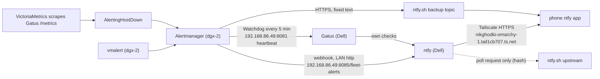

The alert path runs on the Dell, not on a Spark: on 2026-11-15 both Sparks crashed together, and while Gatus and ntfy
lived on dgx-2 nobody was told (PR #55, runbooks/alerting.md).



## Alertmanager routing (`hosts/stacks/observe/alertmanager/alertmanager.yml.j2`)

| Match | Receiver | Timing |
|---|---|---|
| default | `ntfy`: `http://192.168.86.49:8085/fleet-alerts?template=alertmanager`, basic auth user `alerts` | group by `alertname`, `host_name`; wait 30 s; interval 5 min; repeat 4 h; resolved sent |
| `severity="critical"` | `ntfy-critical`: same with `priority=urgent` | repeat 30 min |
| `alertname="Watchdog"` | `gatus-heartbeat`: `POST http://192.168.86.49:8081/api/v1/endpoints/observe_alert-pipeline-heartbeat/external?success=true` (bearer `gatus_heartbeat_token`) | every 5 min |
| `alertname="AlertingHostDown"` | `ntfy-sh-backup-host`: public `https://ntfy.sh/<topic>`, template mode, priority urgent, text "homelab: alerting host unreachable" | wait 0 s, repeat 4 h, no resolved |
| `alertname="AlertDeliveryFailing"` | `ntfy-sh-backup-delivery`: same topic, priority high, "homelab: alert delivery failing" | repeat 4 h |

Inhibitions: `AlertingHostDown` silences `AlertDeliveryFailing`; a critical alert silences the warning with the same
`alertname` and `host_name`. Hermes/WhatsApp as a channel is planned, not built.

## ntfy on the Dell (`hosts/stacks/alerting/ntfy/server.yml.j2`)

| | |
|---|---|
| Version | ntfy 2.38.0 |
| `base-url` | `https://nikghodki-omarchy-1.tail1cb707.ts.net` (Tailscale HTTPS via `tailscale serve`) |
| `upstream-base-url` | `https://ntfy.sh` (iOS instant push: forwards only a poll request with a hash of URL + topic, never the text) |
| Access | `auth-default-access: deny-all`, no sign-up |
| Users | `alerts` (rw on `fleet-alerts`, used by Alertmanager and Gatus), `nikhil` (ro, the phone) |
| Token | one token for `alerts`, label `gatus` |
| Secrets | `secrets/observe.enc.yaml` → `ntfy_alerts_password(_hash)`, `ntfy_alerts_token`, `ntfy_phone_password(_hash)` |
| Published | 127.0.0.1:8085 (tailscale serve) and 192.168.86.49:8085 (Alertmanager, dgx-1 Caddy for `ntfy.nghodki.ai`) |

Users, access and tokens are declarative: ntfy rebuilds `user.db` from the config on start. To change one, put a new
hash in SOPS (`ntfy user hash` inside the ntfy image prints one) and redeploy.

## The phone

1. Tailscale connected (works on mobile data; doesn't need dgx-1 or dgx-2).
2. ntfy app → server `https://nikghodki-omarchy-1.tail1cb707.ts.net` (exactly that: it must equal `base-url` for iOS
   instant push), topic `fleet-alerts`, user `nikhil`, password = `ntfy_phone_password` from SOPS.
3. Second subscription, once: the **backup topic** on `https://ntfy.sh` ("Use another server"), no user. Read the topic
   name on dgx-1 with `sops -d --extract '["ntfy_sh_backup_topic_token"]' secrets/observe.enc.yaml` and never paste it
   anywhere public: anyone who knows it can read and post.

Don't also subscribe through `https://ntfy.nghodki.ai`: it works only while dgx-1 is up, and iOS gets no instant push
for it.

## Heartbeat (Watchdog)

vmalert's `Watchdog` (`vector(1)`) always fires. Alertmanager sends it to Gatus every 5 minutes as a heartbeat. If
Gatus sees nothing for 15 minutes, it alerts on ntfy: VictoriaMetrics, vmalert, Alertmanager or dgx-2 is down.

## Dead man for the Dell

Gatus and ntfy can't report their own host being down, so the check runs on dgx-2 and the message goes around the
Dell:

- **Check:** `AlertingHostDown` (15 min without a successful scrape of the Dell's Gatus).
- **Delivery:** Alertmanager posts straight to `https://ntfy.sh/<topic>` (dgx-2 → internet; no Dell, no Tailscale,
  no dgx-1). The topic is 128 random bits, kept only in SOPS (`ntfy_sh_backup_topic_token`) and in the rendered
  `alertmanager.yml` on dgx-2; Alertmanager shows webhook URLs as `<secret>`.
- **Content-free:** template mode (`tpl=1`) with fixed `t=homelab` and `m=...`, so ntfy.sh stores only that text.
- **Not covered:** dgx-2 down at the same time as the Dell; the house's internet down.

## Test

```bash
# on dgx-2: a test alert end to end (then resolve it by POSTing it with endsAt = now)
docker exec observe-alertmanager-1 amtool --alertmanager.url=http://127.0.0.1:9093 alert add Test severity=warning
# route check for the dead man
docker exec observe-alertmanager-1 amtool --alertmanager.url=http://127.0.0.1:9093 config routes test alertname=AlertingHostDown
# on dgx-1: health of each piece
curl -s http://192.168.86.49:8085/v1/health
curl -s -o /dev/null -w '%{http_code}\n' http://192.168.86.49:8081/health
ssh -n nikghodki@192.168.86.49 'sudo tailscale serve status'
# read the phone's topic without printing the password
PW=$(sops -d --extract '["ntfy_phone_password"]' secrets/observe.enc.yaml)
printf 'user = "nikhil:%s"\n' "$PW" | curl -s -K - 'http://192.168.86.49:8085/fleet-alerts/json?poll=1&since=1h'; unset PW
```

Test the Tailscale HTTPS URL from an admin device (phone, MacBook Air), not from a Spark: the policy lets dgx-1 reach
`tag:agent` on 443, but dgx-2 has no Tailscale grant to the Dell.

Tested 2026-11-15: Gatus and Alertmanager → ntfy end to end (P1.7); an `amtool` alert with the dead-man labels reached
the backup topic within seconds.

## Roll back the move to the Dell

Restore dgx-1's Caddyfile from `~/edge-gateway/conf/Caddyfile.bak-dell-alerting-*`, `docker restart edge-caddy`, revert
PR #55 and redeploy `playbooks/observe.yml` and `playbooks/console.yml`. The old volumes `observe_gatus-data` and
`observe_ntfy-data` on dgx-2 can be deleted once the Dell has run a week.
