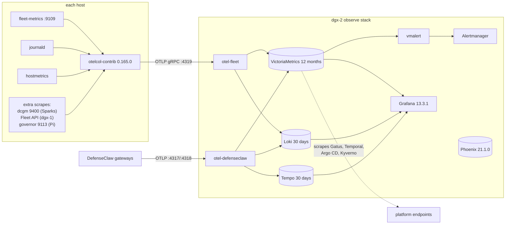

The observe stack runs on dgx-2 (`hosts/stacks/observe`, `playbooks/observe.yml`, `/opt/homelab/observe`). Every host
pushes to it; nothing on the hosts is scraped from dgx-2 except a few platform endpoints. Alert **delivery** runs on the
Dell so it survives a Spark crash ([Alert delivery](alert-delivery.md)).

## Pipeline



## What is collected

On each host, two Ansible roles do the collecting: `fleet_metrics` (the `:9109` agent, `playbooks/fleet-metrics.yml`,
also in `site.yml`) and `otel_host_collector` (`otelcol-contrib` with its config, `playbooks/collectors.yml`).

| Source | Where | How | Lands in |
|---|---|---|---|
| Host metrics (CPU, load, memory, paging, network, processes, disk, filesystems) | every host | `hostmetrics` receiver, 30 s | VictoriaMetrics (`system_*`) |
| Journal (priority info and up) | every host | `journald` receiver | Loki (stream label `host_name` = OS hostname; other resource attributes such as `fleet.host` as structured metadata, unverified) |
| fleet-metrics | every host, `:9109/metrics/prometheus` | 30 s | VictoriaMetrics (`fleet_cpu_percent`, `fleet_memory_*`, `fleet_gpu_percent`, `fleet_temperature_celsius{zone}`, `fleet_power_watts{rail}`, `fleet_uptime_seconds`) |
| GPU (GB10) | Sparks, dcgm-exporter 127.0.0.1:9400 | extra scrape | VictoriaMetrics (`DCGM_FI_DEV_*`: utilization, temperature, power, SM clock, energy). GPU memory is unified: use fleet-metrics |
| Jetson GPU, temperatures, power rails (INA3221) | Jetson | fleet-metrics (sysfs) | VictoriaMetrics |
| DefenseClaw Fleet | dgx-1, `127.0.0.1:18970/api/v1/fleet/metrics`, bearer token | extra scrape, job `defenseclaw-fleet` | VictoriaMetrics (`defenseclaw_fleet_*`) |
| Safety governor | Pi, 127.0.0.1:9113 | extra scrape, 15 s, job `safety-governor` | VictoriaMetrics (`safety_governor_*`) |
| DefenseClaw gateways (logs, traces, metrics) | Jetson ×2, dgx-1 | OTLP to 192.168.86.36:4317/4318, `sensitive` redaction | Loki, Tempo, VictoriaMetrics |
| Lynis, AIBOM, governor interventions, backups | hosts | journal lines with tags `lynis`, `cisco-aibom`, `homelab-aibom`, `safety-governor`, `homelab-backup` | Loki |
| Gatus results | Dell, `192.168.86.49:8081/metrics` | VictoriaMetrics scrape, job `gatus`, 30 s | `gatus_results_*` |
| Temporal | dgx-2, 192.168.86.36:9233 | scrape, job `temporal` | VictoriaMetrics |
| Argo CD, Kyverno | fixed ClusterIPs 10.43.0.100–102, .110, .111 | scrape from dgx-2 via kube-proxy | VictoriaMetrics |
| Stack self-metrics | VictoriaMetrics, vmalert, Alertmanager, both collectors (:8888), Loki, Tempo, Grafana | scrape | VictoriaMetrics |
| LLM and agent traces | apps that send OTLP HTTP to `192.168.86.36:6006/v1/traces` | — | Phoenix. Nothing sends yet: LiteLLM → Phoenix waits for the P0.14 window |

The host collector adds `fleet.host=<inventory name>` to every series and log line (`fleet_host` in PromQL), and is
capped at `MemoryMax` 256M (Pi 128M) with a `memory_limiter`. Its exporter queues up to 2000 batches and retries for
30 minutes, so a short dgx-2 outage loses nothing.

## Storage and retention

| Store | Volume on dgx-2 | Retention | Backed up |
|---|---|---|---|
| VictoriaMetrics 1.156.0 | `observe_vm-data` | 12 months (`-retentionPeriod=12`) | no |
| Loki 3.7.10 | `observe_loki-data` | 30 days (720 h) | no |
| Tempo 2.10.10 | `observe_tempo-data` | 30 days | no |
| Grafana | `observe_grafana-data` | — | no (dashboards are in Git) |
| Phoenix | `observe_phoenix-data` | — | no |
| Alertmanager | `observe_am-data` | silences and notification log | no |

## Versions (images pinned by digest)

VictoriaMetrics/vmalert v1.156.0, Alertmanager v0.35.0, Loki 3.7.10, Tempo 2.10.10, OTel Collector contrib 0.165.0 (both
gateways and the hosts), Grafana 13.3.1, Phoenix 21.1.0. Renovate proposes bumps.

## Operate

```bash
cd ~/homelab/hosts && source ~/.venvs/ansible/bin/activate
ansible-playbook playbooks/observe.yml --check --diff && ansible-playbook playbooks/observe.yml
ansible-playbook playbooks/collectors.yml --limit <host>   # host collector config, extra scrapes, credentials
```

`compose_stack` restarts only the services whose config folder changed. vmalert rules are files in
`hosts/stacks/observe/vmalert/rules/`; a rule change restarts vmalert.

## Gotchas

- Tempo's `metrics_generator` remote-writes to `http://prometheus:9090`, a name that doesn't exist in this stack
  (inherited from DefenseClaw's bundle). Span metrics from Tempo therefore don't reach VictoriaMetrics (unverified
  impact; the DefenseClaw collector makes its own span metrics).
- Grafana-managed alerting is not used (`provisioning/alerting/README.yaml`); all alerts come from vmalert.
- The DefenseClaw overview's firing-alerts count is one higher than real: it counts the always-firing Watchdog (the
  dashboard is vendored unchanged; Fleet Home filters it out).
