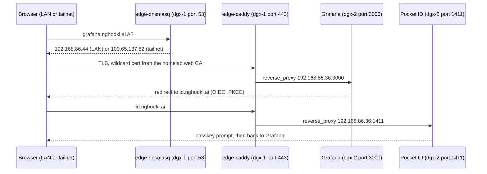
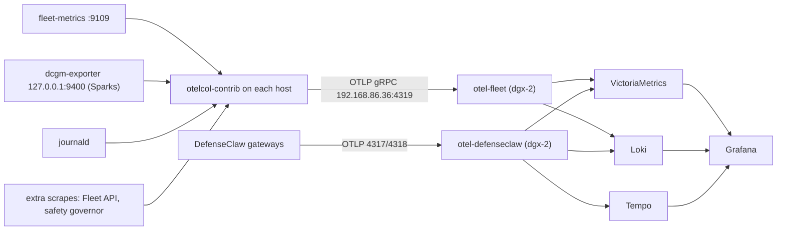
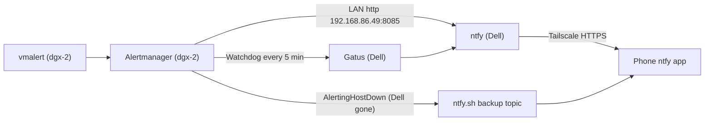
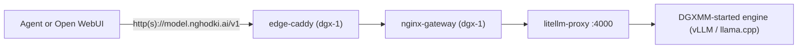
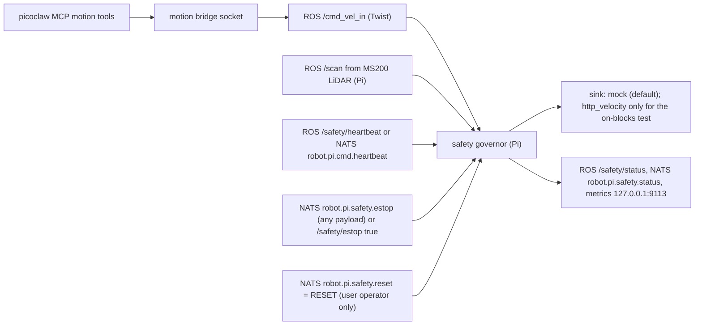

These are the paths that matter most when something breaks. Each one names the hosts and ports involved.

## A browser opens `https://grafana.nghodki.ai`

- DNS: tailnet clients use Tailscale split DNS, which points `nghodki.ai` at dgx-1's Tailscale address. LAN clients
  must use dgx-1 as their resolver for `nghodki.ai` (unverified how each LAN device is configured; the Nest router's
  DHCP doesn't hand it out by itself).
- TLS: the device must trust the homelab web CA, installed once from `http://ca.nghodki.ai`. See [PKI](../security/pki.mdx).
- Every service behind the front door has the same shape. The full table is in [Front door](../network/front-door.mdx).

## A metric or a log line

Details: [Observability](../observability/index.mdx).

## An alert

Details: [Alert delivery](../observability/alert-delivery.mdx).

## A change

1. A pull request to `nikghodki/homelab`. CI runs (lint, secret scanning, code/dependency/config scans, Kubernetes
   checks, AI scanners, AIBOM, unit tests).
2. Merge only when `gh pr checks <n> --watch` exits 0 (decision 0001).
3. Host changes: someone runs the playbook on dgx-1 (`--check --diff` first). Cluster changes: Argo CD polls `main`
   every 2 minutes and applies `cluster/` and `policies/kyverno` (about 3 minutes end to end).

Details: [Deploying](../operations/deploy.mdx).

## A model call

Hermes's main profile calls `http://model.nghodki.ai/v1` with model `qwen3.8-27b` (a model name, not an alias: the
alias plan, P2.0, is still open). The DefenseClaw guardrail plugin for LiteLLM is written and tested but not enabled
yet (P2.4). Details: [Model plane](../agents/model-plane.mdx).

## A robot command and an e-stop

ROS traffic goes through the Zenoh router on the Jetson (`tcp/192.168.86.211:7447`). Details:
[Safety governor](../robotics/safety-governor.mdx).
