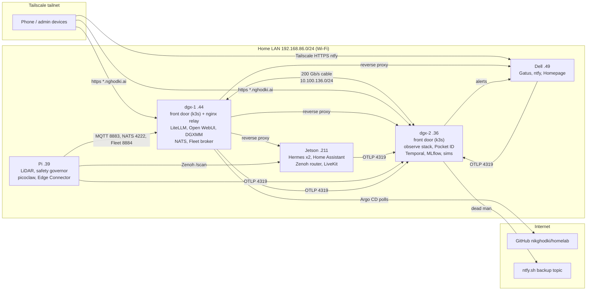

The fleet is six home devices turned into one managed system. Five are managed; the MacBook Air is out of scope.
It runs local LLMs, agents (Hermes, picoclaw), a small robot, simulation jobs, and the platform around them:
observability, alerting, sign-in, a message bus, a k3s cluster and GitOps.

Why it exists: the devices used to run useful pieces independently (DGXMM and LiteLLM on dgx-1, Hermes on the Jetson,
picoclaw on the Pi). The goal (docs/design.md §1) is one fleet that is easy to change, safe to give agents real tools
and a robot, survives any single machine rebooting, and is easy to grow.

## Hosts

| Inventory name | Hostname | Hardware | LAN IP | Tailscale | Role |
|---|---|---|---|---|---|
| [dgx-1](../hosts/dgx-1.md) | `spark-83dc` | DGX Spark, GB10, 20 cores, 121 GiB unified, 3.7 TB NVMe | 192.168.86.44 | 100.65.137.82 | Interactive models (DGXMM, LiteLLM, Open WebUI), half of the front door (k3s) plus the nginx-gateway relay, NATS, DefenseClaw Fleet, Ansible control node, k3s server |
| [dgx-2](../hosts/dgx-2.md) | `nikghodki-dgx-2` | DGX Spark, same as dgx-1 | 192.168.86.36 | 100.124.175.23 | Batch and simulation, observability, Pocket ID, Temporal, MLflow, k3s server (cluster-init) |
| [jetson](../hosts/jetson.md) | `nikhil-jetson` | Jetson Orin, 6 cores, 7.4 GiB, 3.6 TB NVMe, JetPack 7.2.1 | 192.168.86.211 | 100.78.145.123 | Home and robot brain: Hermes (2 profiles), Home Assistant, Zenoh router, LiveKit; etcd member + tainted worker |
| [omarchy](../hosts/omarchy.md) ("the Dell") | `nikghodki-omarchy-local` | Dell Inspiron 7348 (2015), i5-5200U 2c/4t, 8 GB, 500 GB HDD | 192.168.86.49 | 100.117.118.69 | Alerting path (Gatus, ntfy), Homepage launcher, k3s agent; never sleeps |
| [pi](../hosts/pi.md) | `nikghodki-raspberry` | Raspberry Pi 4, 4 cores, 3.7 GiB, 1 TB SD | 192.168.86.39 | 100.64.25.22 | Robot body: LiDAR driver, safety governor, picoclaw, DefenseClaw Edge Connector |
| [MacBook Air](../hosts/macbook-air.md) | — | — | — | — | Out of scope (design D18) |

Every LAN link is Wi-Fi today (Nest Wifi Pro). The two Sparks also have a direct 200 Gb/s cable to each other.

## Picture

## Planes

| Plane | What | Where |
|---|---|---|
| Model | DGXMM (owns the GPUs) behind LiteLLM (`model.nghodki.ai`) | dgx-1 (dgx-2 has a DGXMM engine at times) |
| Agents | Hermes (2 profiles), picoclaw; OpenBot is pending (decision 0004) | Jetson, Pi |
| Events | NATS 2.15.3 with JetStream and MQTT over TLS | dgx-1 |
| Robot | ROS 2 Kilted over Zenoh, safety governor | Pi, Jetson |
| Security | DefenseClaw 1.0.9 per user, Edge Connector + Fleet, scanners in CI, signed images, Kyverno (Enforce) | every host, CI, k3s |
| Observe | OTel collectors → VictoriaMetrics, Loki, Tempo → Grafana; Phoenix; vmalert → Alertmanager → ntfy | collectors everywhere, stack on dgx-2, delivery on the Dell |
| Identity | Pocket ID (passkeys, OIDC), oauth2-proxy | dgx-2 (behind dgx-1's front door) |
| Platform | k3s (3 etcd members), Argo CD + KSOPS, Kyverno, CNPG operator; kube-vip and the `*.nghodki.ai` front door (Caddy + CoreDNS) | Sparks (+ Jetson etcd, Omarchy agent) |
| Change | Git PRs, GitHub Actions CI, Ansible from dgx-1, Argo CD pulling `cluster/` | GitHub, dgx-1, k3s |

## What lives outside the repo

Some pieces are hand-run and not managed by Ansible or Argo CD yet. Know them before you change anything:

| Piece | Host | Where | Plan |
|---|---|---|---|
| Old front door: `edge-caddy` + `edge-dnsmasq` | dgx-1 | `~/edge-gateway` | Replaced for clients by the in-cluster door at the P3.3 cutover ([Front door](../network/front-door.md#in-cluster-front-door-p33)); kept as the nginx-gateway relay and the rollback until P3.7 |
| `nginx-gateway` (routes model, DGXMM, TTS, HA; its voice page is unreachable since D26) | dgx-1 | `~/voice-assistant/nginx/nginx.conf` | — |
| LiteLLM proxy + Postgres + Redis | dgx-1 | `~/litellm-setup` (owned by the DGXMM/LiteLLM session) | P3.7 |
| Open WebUI | dgx-1 | container `open-webui` | P3.7 |
| DGXMM and its engines | dgx-1, dgx-2 | `~/workspace/dgx-model-manager` (separate project) | stays outside k3s (D3) |
| Coolify | dgx-1 | container `coolify` | stays a host app |
| Hermes, Home Assistant, LiveKit, control center (voice retired, D26; these two stay for now) | Jetson | user units of `nikjetson` / `hermes-nikhil`, container `homeassistant` | Hermes moves into k3s in P4.5 |
| picoclaw's own config and binaries | Pi | `/var/lib/picoclaw` (user and unit managed by role `picoclaw` since #73; the agent config itself isn't in Git) | — |
| DefenseClaw installs | dgx-1, Jetson ×2, Pi | per-user release installers; Ansible manages policy, PATH, Fleet settings | — |

Next: [Main flows](flows.md).
