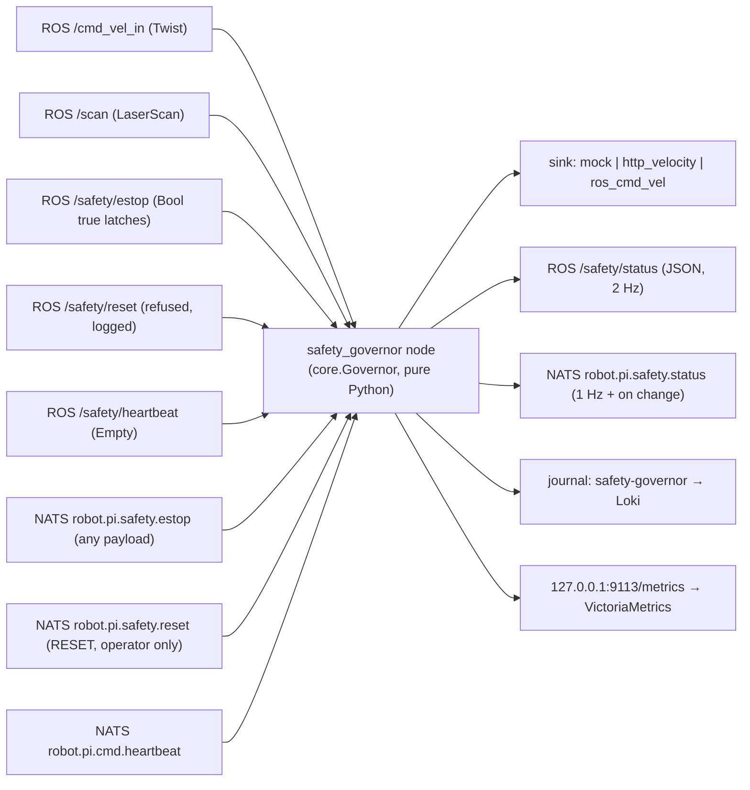

Plan P5.2, `robots/safety/governor/`, limits in `robots/safety/limits.yaml`, role `safety_governor` (play "Safety
governor" in `hosts/playbooks/robot.yml`), runbooks/robot-safety.md. It enforces, without any agent or LLM: a latched
**e-stop**, **speed caps**, an **obstacle stop** from `/scan`, and **watchdogs** (heartbeat 2 s, command 0.5 s,
`/scan` 1 s).

**As deployed, it drives a mock sink: it never sends anything to the motors.** A real sink is enabled only on the
command line for the on-blocks test.

## Inputs and outputs



## Rules (first match wins)

| # | Condition | Output | State |
|---|---|---|---|
| 1 | e-stop latched | zero | `estop` |
| 2 | no `/scan` yet, older than 1 s, or under 20% valid ranges | zero | `fault` |
| 3 | no heartbeat within 2 s | zero | `fault` |
| 4 | no command within 0.5 s | zero | `idle` |
| 5 | command not finite, or above the ceiling (0.5 m/s, 2.5 rad/s) | zero | `rejected` |
| 6 | obstacle closer than 0.35 m within ±35° of the travel direction | translation zero, turning kept | `limited` |
| 7 | above the caps (0.2 m/s, 1.0 rad/s) | clamped | `limited` |
| 8 | otherwise | as commanded | `ok` |

- Sideways motion is forced to 0 (`allow_strafe: false`). Travel direction is `atan2(vy, vx)`, so **reversing away from
  an obstacle is allowed**.
- Ranges that are inf/NaN, below `range_min`, or within 0.08 m (the robot's body) are ignored. `lidar_yaw_deg` (0 now)
  maps the LiDAR's 0° to the robot's forward; check it on blocks.
- Zero is sent to the sink at 10 Hz in every non-moving state, and once more on exit. If the node is down, nothing calls
  the car and the firmware's 500 ms deadman stops it. The watchdogs don't latch.

## E-stop and reset

- **Latch:** `/safety/estop true`, or **any** message on NATS `robot.pi.safety.estop`. `/safety/estop false` does not
  clear it.
- **Reset is human-only** (PR #60). Only the NATS user `operator` (and `admin`) may publish `robot.pi.safety.reset`, with
  payload `RESET`. `picoclaw` and `hermes` have a deny on it: the server refuses the publish (`Publish Violation` in
  `docker logs bus-nats-1` on dgx-1). The ROS `/safety/reset` is off (`safety_governor_ros_reset_enabled: false`)
  because any Zenoh node could publish it; attempts are logged as `INTERVENTION kind=reset_refused`. The core also
  refuses any reset source but NATS. Commands received before the reset are dropped.
- **Heartbeat:** the commanding side must send `/safety/heartbeat` or `robot.pi.cmd.heartbeat` at least every 2 s (5 Hz
  is good). No heartbeat, no motion.

```bash
safety-estop                 # latch (Pi: as picoclaw; dgx-1: as operator)
safety-estop status          # JSON: state, reason, estop, last_stop, input ages, nearest_m per quadrant, sink, limits
safety-reset                 # clear (as operator); exits 0 once the governor reports it clear
ros2-kilted topic pub --once /safety/estop std_msgs/msg/Bool "{data: true}"     # works without NATS
```

`safety-reset` reads the operator password with `sudo -n cat /etc/safety-operator/nats-operator.json` and passes it on
stdin, never on a command line. On dgx-1 both commands are in `~/.local/bin` with nats-py 2.14.0 in a hash-locked venv
(`~/.local/share/safety-cli/venv`), installed by `playbooks/bus.yml`.

Limit: picoclaw runs as the Pi's login user with passwordless sudo, so it could read the operator file or stop the
governor. Fully human-only needs picoclaw under its own user (follow-up).

## Files on the Pi

| What | Where |
|---|---|
| Unit | `~/.config/systemd/user/safety-governor.service` (`Restart=always`, after `ros-lidar`, `SyslogIdentifier=safety-governor`) |
| Code | `~/.local/lib/safety-governor/safety_governor/` |
| Config | `~/.config/safety-governor/governor.json` (from `limits.yaml` + role vars) |
| NATS credentials (picoclaw) | `~/.config/safety-governor/nats-credentials.json` (0600) |
| Operator credentials | `/etc/safety-operator/nats-operator.json` (root 0600), also on dgx-1 |
| CLIs | `~/.local/bin/safety-estop`, `~/.local/bin/safety-reset` |
| Integration test | `~/.local/lib/safety-governor/run-integration-test` |

Role variables: `safety_governor_sink` (`mock`), `safety_governor_real_sink_enabled` (`false`),
`safety_governor_http_url` (empty), `safety_governor_limit_overrides` (`{}`), `safety_governor_ros_reset_enabled`
(`false`). The node refuses unknown keys and contradictory limits. Change limits in `robots/safety/limits.yaml` while the
robot is docked, PR, then `ansible-playbook playbooks/robot.yml --limit pi --check --diff` and for real.

## Alerts

| Alert | Fires when | Severity |
|---|---|---|
| `SafetyGovernorStatusStale` | no status for 60 s or no metric for 3 min, for 2 min | critical |
| `SafetyGovernorLidarStale` | no `/scan` for > 5 s, for 5 min | warning |
| `SafetyGovernorRealSinkEnabled` | a real sink on for 2 h | warning |

Metrics: `safety_governor_status_timestamp_seconds`, `_estop_latched`, `_state{state}`, `_scan_age_seconds`,
`_nats_connected`, `_real_sink`, `_interventions_total{reason}`.

## Tests

- **Unit** (CI): `cd robots/safety/governor && PYTHONPATH=. python -m pytest -q tests`: latch and reset, clamping,
  ceiling, obstacle sector (edges, reversing, strafing, yaw, the real MS200 geometry, invalid ranges), watchdogs,
  precedence, sinks.
- **On the Pi** (mock sink only): `run-integration-test` starts a throw-away governor in ROS domain 73 on NATS
  `robot.pi.safety.test.*`, feeds fake `/scan`, commands and heartbeats, sends e-stops, stops inputs, and checks the mock
  sink's log. 22/22 checks on 2026-11-15, about 25 s.

## The on-blocks test (for you; not done yet)

Required before the governor drives the real car for the first time, after any limit or code change, and as gate 2 of a
policy rollout. The car must be **on blocks with all wheels off the ground**, hand on its power switch.

1. Find the car's IP (router DHCP list; `roboclaw.local` doesn't resolve); `curl -s http://<car-ip>/status`.
2. Make sure nothing else drives it: don't ask picoclaw to move (its tools bypass the governor); `pgrep -fa
   cmd_vel_bridge` shows nothing.
3. `systemctl --user is-active ros-lidar safety-governor`; `safety-estop status` shows the mock sink; run the
   integration test.
4. Enable the real sink only for the test, from dgx-1:
   `ansible-playbook playbooks/robot.yml --limit pi --diff -e safety_governor_sink=http_velocity -e safety_governor_real_sink_enabled=true -e safety_governor_http_url=http://<car-ip>`
5. Heartbeat in one terminal: `ros2-kilted topic pub -r 5 /safety/heartbeat std_msgs/msg/Empty "{}"`.
6. Run the four checks in runbooks/robot-safety.md: e-stop (NATS and ROS, reset), speed cap (0.4 → clamped to 0.2;
   0.8 → rejected), obstacle stop (board at 25 cm ahead stops forward, reverse allowed, spin allowed, board behind stops
   reverse), watchdog (stop the heartbeat, the LiDAR, the governor: wheels stop in about 2 s, 1 s, 0.5 s).
7. Back to the mock sink: run the playbook again without `-e`. `safety-estop status` must show `"real": false`.
8. Record date, commit, pass/fail per check in the PR or issue.

## How the car is driven today (paths that bypass the governor)

| Path | Through the governor? |
|---|---|
| picoclaw MCP `picoclaw-hardware` → car `/drive`, `/turn` | **no** |
| Nav2 (later) → `/cmd_vel` → `cmd_vel_bridge` (not running) → `/velocity` | **no** (it must publish `/cmd_vel_in` instead) |
| Jetson control center → `/stop` | stop only |
| the governor's `http_velocity` sink → `/velocity` | yes |

The car accepts calls from anything on the LAN. Closing these is listed under [picoclaw](../agents/picoclaw.mdx).
