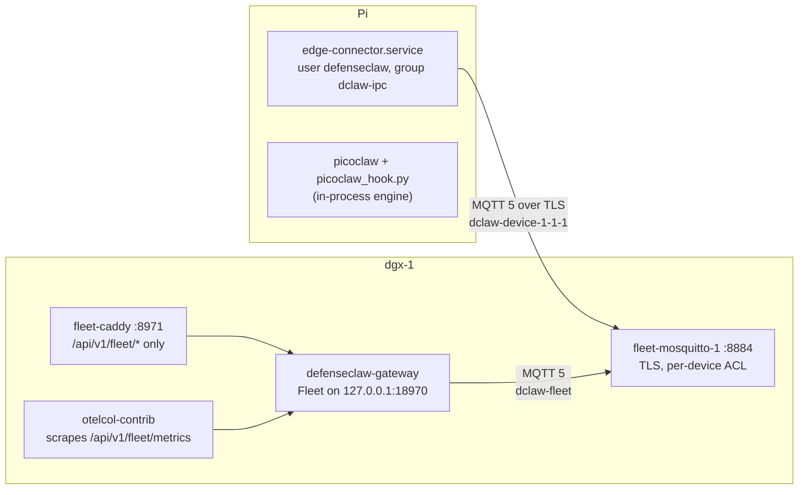

The Edge Connector is DefenseClaw's C daemon for small devices. On the Pi it registers with the Fleet gateway on dgx-1,
sends signed heartbeats, receives signed policy and emergency commands over MQTT, and keeps a hash-chained audit log.
Plan P1.12, decision D24, runbooks/edge-connector.md.



## Pieces

| Piece | Where | Managed by |
|---|---|---|
| Fleet gateway (`fleet.*` config, `.env` secrets) | dgx-1 `~/.defenseclaw` | role `defenseclaw_fleet` |
| MQTT broker `fleet.nghodki.ai:8884` | dgx-1 `/opt/homelab/fleet`, Mosquitto 2.1.2, TLS 1.2+, no anonymous | `playbooks/fleet.yml` |
| Fleet API proxy `fleet.nghodki.ai:8971` | dgx-1, Caddy 2.11.9 (host network), `admin off`, only `/api/v1/fleet/*` → 127.0.0.1:18970, everything else 404 | `playbooks/fleet.yml` |
| Device daemon `edge-connector.service` | Pi, `/usr/local/bin/edge-connector` | role `edge_connector` (`playbooks/edge-connector.yml`) |
| Device policy | `policies/defenseclaw/edge/fleet-1-1.yaml` | pushed by hand |
| Secrets | `secrets/fleet.enc.yaml`; `pki_fleet_key` in `secrets/pki.enc.yaml` | SOPS |

Why a separate broker and not NATS: the Fleet gateway's Go MQTT client (paho.golang) speaks **only MQTT 5**, and NATS's
MQTT listener is 3.1.1. DefenseClaw's docs say 3.1.1 (upstream draft 04).

## Device identity

| | |
|---|---|
| IDs | tenant 1, fleet 1, device 1. The composite ID is `tenant<<48 \| fleet<<32 \| device` |
| MQTT user | `dclaw-device-1-1-1`, password `mosquitto_dclaw_device_1_1_1_password` (hash in the broker's `passwd`) |
| Device key | `dclaw_device_key_1_1_1` (hex in SOPS) → `/etc/defenseclaw/device.key`, raw 32 bytes, root:defenseclaw 0640. Written from stdin, never on a command line |
| Audit key | `dclaw_audit_key_pi` → `DCLAW_AUDIT_KEY` |
| Shared keys | `dclaw_ota_hmac_key` (signs policy), `dclaw_emergency_key` (emergency commands) |
| Env file | `/etc/defenseclaw/edge-connector.env`, root 0600 (systemd reads it before dropping privileges) |
| IPC | socket owned by group `dclaw-ipc`; `DCLAW_IPC_ALLOWED_UID/GID` = `nikghodki-raspberry-1` (`edge_connector_ipc_user`). picoclaw itself (user `picoclaw` since #73) isn't in the group: its hook doesn't use the socket |
| Mode | `DCLAW_STRICT_MODE=1`: an undecided call waits for Fleet and stays blocked without it |
| Unit hardening | `User=defenseclaw`, `Group=dclaw-ipc`, `ProtectSystem=strict`, `ProtectHome=yes`, `NoNewPrivileges`, `MemoryMax=64M` |

## Broker ACLs (`hosts/stacks/fleet/mosquitto/acl.j2`)

Topic layout `defenseclaw/{tenant}/{fleet}/{device}/...`.

| User | Access |
|---|---|
| `dclaw-fleet` (the gateway) | readwrite `defenseclaw/#` |
| `dclaw-device-1-1-1` | write `.../1/1/1/register`, `.../heartbeat`, `.../verdict/req`; read `.../1/1/1/verdict/resp`, `defenseclaw/1/1/ota/policy`, `defenseclaw/1/1/ota/emergency` |

## Policy (`policies/defenseclaw/edge/fleet-1-1.yaml`)

Skills: CRITICAL/HIGH disabled at runtime, MEDIUM warn. IoT extensions: block the capability sequences
`net_fetch → exec_shell`, `net_fetch → actuate`, `sensor_read → net_fetch → exec_shell`; empty destination allowlist;
canary baseline 5 blocks per minute.

```bash
# on dgx-1 (needs the homelab CA)
export REQUESTS_CA_BUNDLE=/etc/ssl/certs/ca-certificates.crt
defenseclaw edge-connector policy push policies/defenseclaw/edge/fleet-1-1.yaml --tenant-id 1 --fleet-id 1
```

The gateway compiles, signs (HMAC) and publishes it on `defenseclaw/1/1/ota/policy`. The device logs
`Policy tables reloaded from flash` and `policy_version` goes up. Each device runs a 10-minute canary and rolls back by
itself if blocks exceed 5× baseline for 3 minutes (`CANARY_ROLLBACK` in heartbeats, alert `EdgeCanaryRollback`).

Emergency: `defenseclaw edge-connector policy emergency {block-all|enter-lockdown|release-lockdown|revoke-sessions|force-sync} --tenant-id 1 --fleet-id 1`.

## Build and install on a device

The production build needs mbedTLS 3 (`libmbedtls-dev`). Debian's 3.6 deprecates APIs the engine uses, and the build
uses `-Werror`, so add `-Wno-error=deprecated-declarations` (upstream draft 01):

```bash
cd ~/src/defenseclaw-<version>        # same version as the gateway
cmake -S edge-connector -B edge-connector/build-prod -DCMAKE_BUILD_TYPE=Release \
  -DDCLAW_PROFILE=STANDARD -DDCLAW_DEV_MODE=OFF -DDCLAW_ALLOW_HMAC_OTA=ON \
  -DCMAKE_C_FLAGS=-Wno-error=deprecated-declarations
cmake --build edge-connector/build-prod -j4
ctest --test-dir edge-connector/build-prod --output-on-failure
sudo cmake --install edge-connector/build-prod && sudo ldconfig
```

Then from dgx-1: `ansible-playbook playbooks/edge-connector.yml` (the role does nothing until the binary exists).
Upgrade gateway and devices together.

## Add a device

1. Pick IDs (tenant, fleet, device).
2. Generate a Mosquitto password and its PBKDF2-SHA512 (`$7$`) hash into `secrets/fleet.enc.yaml`
   (`mosquitto_dclaw_device_T_F_D_password` and `_hash`); add the user to `hosts/stacks/fleet/mosquitto/passwd.j2` and
   its exact-topic ACL to `acl.j2`; add the hash variable to `playbooks/fleet.yml`.
3. Register **once** over HTTPS on dgx-1 (registering again replaces the key):
   `defenseclaw edge-connector register D --tenant-id T --fleet-id F --json`. Store `device_key` as
   `dclaw_device_key_T_F_D` and the device's audit key as `dclaw_audit_key_<host>`. Never print either.
4. `edge_connector_device_id` and `edge_connector_ipc_user` in the host's `host_vars`; apply `fleet.yml`, then
   `edge-connector.yml`.
5. `defenseclaw edge-connector devices` shows it `degraded` until its first Fleet verdict sets its clock, then `online`.

## Metrics and alerts

dgx-1's host collector scrapes `GET /api/v1/fleet/metrics` on 127.0.0.1:18970 (job `defenseclaw-fleet`) with the admin
token, passed by systemd `LoadCredential` from `/etc/otelcol-contrib/credentials/fleet-api-token` (root 0600, written by
`playbooks/collectors.yml`). Metrics `defenseclaw_fleet_*`; dashboard "DefenseClaw IoT Fleet" (`/d/defenseclaw-fleet`).
Alerts (`vmalert/rules/edge.yml`): `EdgeDeviceOffline`, `EdgeCanaryRollback`, `EdgeOtaRollback`. Gatus checks the broker
(TCP 8884) and the API (`/api/v1/fleet/health` must answer 401 without a token; cert must have > 14 days).
After rotating the token: `playbooks/collectors.yml --limit dgx-1`.

## Known limits (1.0.9)

- **The OSS Fleet gateway denies every escalated tool hash.** `sidecar.go`: "Default-deny ... when no cloud inspection
  pipeline is configured". There is no API to allow a hash; `threat-intel/push` only revokes. With strict mode, any
  call the device can't decide locally is blocked (draft 02).
- **The C engine's tool table** lacks picoclaw's `message`, `i2c`, `serial`, `spawn`, `cron`; those fail closed with
  `INVALID_INPUT` (draft 03).
- **`picoclaw_hook.py` is FFI-only**: it loads the engine in-process and never uses the daemon socket, so picoclaw's
  calls never reach Fleet through it (draft 03; hook part in open upstream PR #1343).

So picoclaw keeps its in-process hook (`/var/lib/picoclaw/.defenseclaw/bin/picoclaw_hook.py` since picoclaw got its
own user, #73; picoclaw is not in `dclaw-ipc`). Fleet is live for registration, signed
heartbeats, signed policy, emergency commands and audit. The `dclaw-ipc` group is ready for a daemon-backed hook.

The old SSH tunnel to the Jetson's gateway (`dclaw-tunnel` user unit on the Pi) was supposed to be retired in P1.12;
it is still enabled ([discrepancies](../decisions/discrepancies.mdx)).
