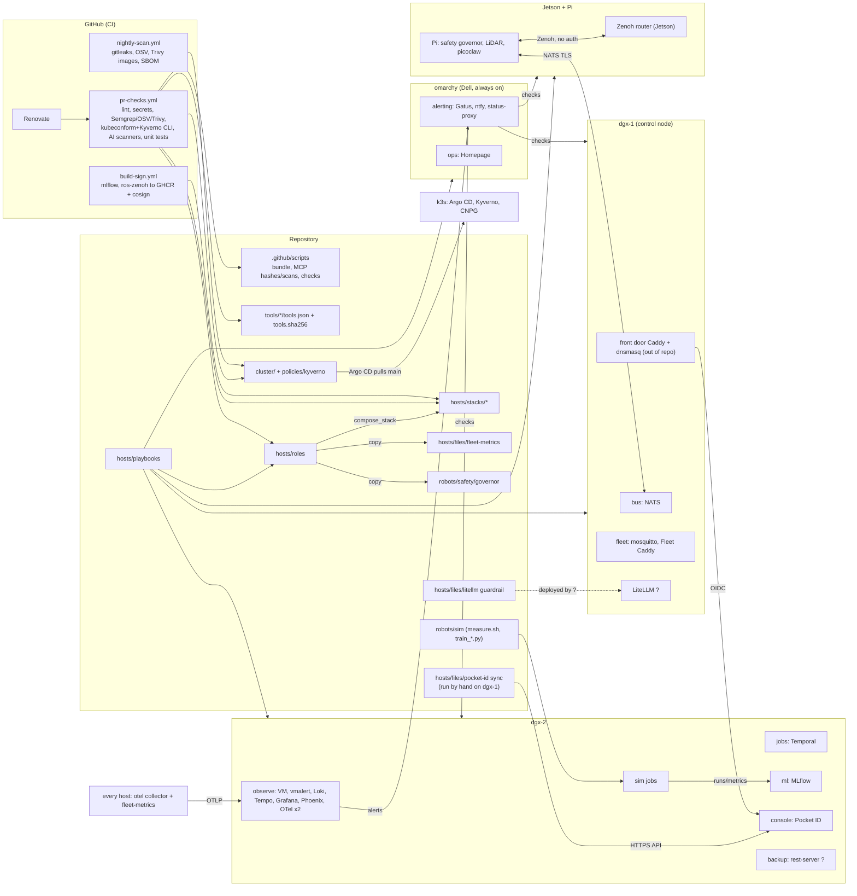

# Code review, 2026-11-15

This review covers the whole repository at `c91dcbb` (origin/main when it started): Python, shell, Ansible, compose,
Kubernetes, Argo CD, Kyverno, GitHub Actions, Jinja templates and Dockerfiles. Fixes are in the PR that adds this file,
rebased onto `911a3d4`. Line numbers refer to `c91dcbb`. #73 (robot-path-hardening) merged during the review, and #1 and #35 are updated for it.

Files other agents were changing during the review were reviewed but not edited. Those were the open PRs and
worktrees `p3.3-edge-in-cluster` (#72), `docs-site-mdx` (#71) and `robot-path-hardening` (uncommitted), plus
`p4.3-mcp-admission`, `lynis-remediation`, `p3.5-enforce` and `p3.5-sbom-size`, which were merged during the review.
Findings in those files are marked *deferred: in flight*.

## System map

Unknown or unverified edges are marked `?`.

Trust boundaries in this map:

- SOPS secrets enter through `community.sops.load_vars` on the controller and `sops` in pocketid_sync.
- sudo/become applies to most roles.
- Docker group/socket access: fleet-metrics, cisco-aibom.
- NATS/MQTT messages reach the governor and the Fleet gateway.
- Zenoh (no auth) reaches the governor.
- HTTP from agents: LiteLLM guardrail to DefenseClaw, and fleet-metrics on the LAN.
- LLM output: picoclaw's motion commands go to the governor, and picoclaw runs as the governor's own account.

## Rubric

Each finding has these columns:

- **Severity:** *bug* (verified wrong behaviour), *should-fix* (wrong or fragile, lower impact or latent), or *nice-to-have*.
- **Kind:**
  - *defect*: verifiably wrong, checked with a test or a reasoning trace.
  - *design-alt*: a legitimate tradeoff. The tradeoff is given in one line, with no verdict.
- **Failure mode:** what the code assumes, and what happens when that is false.
- **Trust boundary:** where untrusted input crosses into a privileged action, if anywhere (`-` = none).
- **Status:**
  - *fixed* (in this PR)
  - *deferred: in flight* (the file was being changed by another agent)
  - *deferred: other* (the reason is in the row)
  - *decision* (needs the owner)

This review reports facts only. Patterns are not presented as mandatory.

## Findings

### Bugs

| # | Where | What | Failure mode | Trust boundary | Kind | Suggested change | Status |
|---|---|---|---|---|---|---|---|
| 1 | `robots/safety/governor/safety_governor/core.py:178`, `hosts/roles/safety_governor/templates/safety-governor.service.j2:18`, `hosts/roles/safety_governor/tasks/main.yml:101-134`, `hosts/roles/edge_connector/handlers/main.yml:10-14` | The e-stop latch is held only in memory. Every governor restart clears it: a deploy (the handlers fire on code, config, credentials, **and** the unrelated `safety-estop`/`run-integration-test` wrappers), `Restart=always` after a crash, a `user@` restart (edge_connector handler), or `systemctl --user restart` by the Pi login account. Since #73, picoclaw runs as its own user and can't do this, but the motion bridge's `stop` relies on the same latch. | Assumes the governor process lives longer than an e-stop. If it doesn't, the robot accepts fresh commands again without an operator `RESET`. That contradicts `runbooks/robot-safety.md:73` ("Reset is human-only"). | Before #73: LLM agent to safety (same account). After #73: operator and deploy actions only. | defect | Either persist the latch (e.g. `~/.local/state/safety-governor/estop`, cleared only by `reset`), or start latched. Also drop `notify` from the wrapper items. Tradeoff: a persisted latch survives reboots; starting latched needs a human reset after every boot. | decision; deferred: other (safety design choice; the role was in flight until #73) |
| 2 | `robots/sim/measure.sh:37-38` | `cg=$(($(cat .../memory.current) / 1048576))`: if the container's cgroup is gone (it exits between `docker ps` and the read) or the path differs, the read is empty. That is an arithmetic syntax error, and bash abandons the whole `while` sampling loop (the current top-level command; `\|\| true` doesn't help). | Sampling **and the MemAvailable watchdog** stop for the rest of the job, silently (stderr goes to /dev/null). The script then just waits for the job. Reproduced with stub `docker`/`nvidia-smi`. | - | defect | Check every value before arithmetic; leave cgroup fields empty. | fixed |
| 3 | `hosts/stacks/observe/vmalert/rules/fleet.yml:6` | `FleetHostSilent`: `time() - timestamp(x) > 300`. An instant selector only sees samples inside the 5 m query step, so a silent host drops out of the result before its age reaches 300 s. | The alert can never fire for a dead host. Reproduced on a throwaway VictoriaMetrics v1.156.0: the old expression returned only the live host; `lag(x[1d]) > 300` returned the silent one (392 s). | - | defect | `max by (host_name) (lag(system_memory_usage_bytes{state="used"}[1d])) > 300` | fixed |
| 4 | `hosts/stacks/observe/tempo/tempo.yaml:35` | The metrics generator remote-writes to `http://prometheus:9090`, but the observe stack has no `prometheus` service (VM is `victoriametrics:8428`). | Span metrics and service graphs are never stored, so the Grafana service map stays empty. | - | defect | `http://victoriametrics:8428/api/v1/write` (an "adapted" bundle file, so the bundle check still passes) | fixed |
| 5 | `hosts/files/fleet-metrics/fleet_metrics/collect.py:67` | Jetson `gpu.0/load` is per-mille (the test says so), but values `<= 100` were passed through as percent. | A 5 % GPU load (raw 50) was reported as 50 %, 10x too high for every load up to 10 %. | - | defect | Always divide by 10. | fixed |
| 6 | `hosts/roles/defenseclaw_aibom/files/homelab-aibom.py:30-35` | On a second run the same day, `previous[-1]` is today's own file, so the run reports `changed: null` ("first run") and overwrites the file. | Components added between the two runs are never reported, not even the next day, because the baseline then already contains them. Reproduced against the old code. | - | defect | Exclude today's file from `previous` (as cisco-aibom-fleet does). | fixed |
| 7 | `hosts/roles/defenseclaw_fleet/tasks/main.yml:41,51` | `have.get(key, false) != value` treats a missing key as `false`, so `allow_key_over_http: false` and `auto_register: false` are never written when they are absent. `fleet: null` crashes `.get`. | On a fresh or edited config, two security settings fall back to the gateway default, silently. Both cases were reproduced with a local play. | Gateway security config | defect | `item.key not in have or have[item.key] != item.value`; `default({}, true)` | fixed (takes effect on the next `defenseclaw.yml` run; may write two keys and restart the gateway once) |
| 8 | `hosts/files/litellm/defenseclaw_guardrail.py:81-83` | A JSON answer that isn't an object (`[]`, `"allow"`, `1`) raised `AttributeError`, which `async_pre_call_hook` doesn't catch. | Prompts are meant to fail open on "no verdict"; instead the user's chat call failed. Tool calls failed either way. | HTTP from DefenseClaw | defect | Treat a non-dict answer as no verdict. | fixed (takes effect when LiteLLM next loads the file; how it is deployed is `?`) |
| 9 | `hosts/files/pocket-id/pocketid_sync.py:95-96` | The client update check compares callbacks, name, PKCE and launch URL, but not `logoutCallbackURLs`. | Latent: no client sets logout URLs today. Once one does, edits never reach Pocket ID. | - | defect | Compare `logoutCallbackURLs` too. | fixed |
| 10 | `policies/kyverno/*.yaml` (`matchConstraints.resourceRules`) | All policies match `pods` only. Ephemeral containers are added through `pods/ephemeralcontainers`, which isn't matched. | `kubectl debug` can add a privileged, unsigned, undigested container from any registry. The `ephemeralContainers` CEL paths never run on CREATE. | k8s RBAC | defect | Add `pods/ephemeralcontainers` (UPDATE) to the image and privilege policies, with a Kyverno CLI test. | deferred: in flight (`restrict-registries.yaml` in #72; the others were just changed by P3.5) |
| 11 | `hosts/stacks/observe/vmalert/rules/gitops.yml:34-40` | `KyvernoAdmissionDegraded` reads `kube_deployment_status_replicas_available`, but kube-state-metrics isn't deployed or scraped on main. | The alert can never fire. | - | defect | Lands with kube-state-metrics in #72, or alert on `up{job="kyverno-admission"}`. | deferred: in flight (#72) |
| 12 | `hosts/roles/ros_lidar/tasks/main.yml:7-11` | The role adds the account to `dialout`, but only `ros-lidar` (a user unit) is restarted. The user manager keeps its old groups (`edge_connector/handlers/main.yml:9` notes the same). | On a fresh Pi, the LiDAR driver can't open `/dev/ttyUSB0` until a reboot. | - | defect | Restart `user@<uid>` when the group changed. That also restarts the governor, so fix #1 first. | decision |

### Should-fix

| # | Where | What | Failure mode | Trust boundary | Kind | Suggested change | Status |
|---|---|---|---|---|---|---|---|
| 13 | `.github/workflows/nightly-scan.yml:42-49` | Each image scan was a fresh `docker run` with no cache, so it downloaded the Trivy DB about 20 times. Every non-zero exit was reported as "CRITICAL findings". | A DB or registry error (rate limit) looked like a vulnerability. | - | defect | Download the DB once into `$RUNNER_TEMP`, scan with `--skip-db-update`, use `--exit-code 5` for findings, and list errors separately. | fixed |
| 14 | `.github/workflows/nightly-scan.yml:39` | The image list was grepped from `.github cluster` only, so none of the images that run on the hosts were scanned. | Advisories for Grafana, Loki, Pocket ID, NATS, Temporal and others went unseen. | - | defect | Add `hosts` (not `robots`: the Isaac Lab base is too big for a hosted runner). | fixed |
| 15 | nightly-scan runs 43735155611 and 43790789073 | The nightly has been red because of real CRITICAL findings in CI tool images: gitleaks v8.30.1 (5) and actionlint 1.7.12 (2). With #14 it also shows runtime images: Phoenix 9, ros-base 5, rest-server 4, ksops 3, dcgm-exporter 2, postgres 1. | The red is real, so an additional failure would not stand out. | - | defect | Bump when upstream fixes, or `.trivyignore` with an expiry. These images only run in CI, read-only. | decision |
| 16 | `robots/safety/governor/safety_governor/nats_bridge.py:63-65` | The credentials and CA were read before the retry loop, in a task nobody awaits. | With a missing or late file, the bridge task died: no governor log line, no retry, and no NATS e-stop until a restart (only `safety_governor_nats_connected 0` showed it). | NATS e-stop path | defect | Read the files inside the retry loop. | fixed (takes effect on the next `robot.yml` deploy, which **restarts the governor and clears a latched e-stop**, see #1) |
| 17 | `hosts/files/pocket-id/pocketid_sync.py:34` | `sops set FILE KEY VALUE` put each new OIDC client secret on the command line. | The secret was visible in `ps` and `/proc/<pid>/cmdline` while sops ran. | SOPS | defect | `sops set --value-stdin` (sops 3.13.3 on dgx-1; checked with a throwaway age key). | fixed |
| 18 | `hosts/roles/restic_install/tasks/main.yml:24-29` | bz2 was unpacked straight to the final path, guarded by `creates:`. | An interrupted run left a truncated binary that `creates:` and the "installed" stat accept for ever, so backups would fail every night. | - | defect | Unpack to `restic.tmp`, then `os.replace`. | fixed |
| 19 | `hosts/roles/restic_backup/tasks/main.yml:50-53` | Any `restic cat config` failure (DNS, TLS, wrong password) falls through to `restic init`, and `no_log` hides the error. | A misleading failure. Init refuses an existing repo, so there is no data loss. | SOPS | defect | Run `init` only on exit code 10 ("repository does not exist"); otherwise fail and print stderr. | deferred: other (needs restic + a REST server to test; backups are off, decision 0002) |
| 20 | `hosts/roles/restic_backup/templates/env.j2:1` | The REST password sits raw in the URL userinfo. | A password containing `@ : / # ?` breaks the repository URL. | SOPS | defect (latent) | `RESTIC_REST_USERNAME` / `RESTIC_REST_PASSWORD` | deferred: other (as #19) |
| 21 | `hosts/roles/base/templates/52homelab-unattended-upgrades.j2:2-6` | apt lists are appended across files. This file doesn't clear the distribution's `Origins-Pattern`/`Allowed-Origins`, so "security only" is not true. On Debian the default point-release pattern stays. | The Pi and other Debian hosts also take point-release updates automatically. | - | defect | Start with `#clear Unattended-Upgrade::Origins-Pattern;` and `#clear Unattended-Upgrade::Allowed-Origins;`. Tradeoff: point releases contain fixes the owner may want. | decision (the hardening role from #70 just landed in this area) |
| 22 | `hosts/roles/defenseclaw_policy/tasks/account.yml:31-41` | `policy validate` runs after `policy activate`, and the gateway reloads on activate. | A bad policy goes live before the run fails. | Policy enforcement | defect | Validate before activating, if the CLI can validate an inactive file (`?`). | deferred: in flight at review time (merged in #67) |
| 23 | `hosts/stacks/ml/compose.yaml:32`, `hosts/stacks/sim/compose.yaml:32,50`, `hosts/roles/compose_stack` | Locally built images keep a hand-written tag. A Dockerfile or requirements change (including a Renovate FROM bump) is never rebuilt on the host, because `docker_compose_v2` runs with `pull: missing` and no build policy. | The host runs the old image while the repo says otherwise. | - | defect | Derive the tag from the build inputs, or pass `build: always` for stacks with `build:`. | deferred: other (changes deploy behaviour; needs an owner choice) |
| 24 | `renovate.json:59-66` and role defaults | `requirements-radar.txt` was not managed. Also unmanaged: `hosts/stacks/ml/mlflow/requirements.txt`, `ros_zenoh_router_base_image` (in `Dockerfile.j2`), the `k3s`/`otel`/`restic`/`nats-py` versions in role defaults, the `BUILDX_URL`/`COSIGN_URL` binaries, and the Argo CD chart `targetRevision`s. | These pins silently go stale. | - | defect | radar: added. The rest: regex managers with `# renovate:` comments; `argocd.managerFilePatterns`. | fixed (radar); deferred: other (rest; build-sign.yml was in flight) |
| 25 | `hosts/` (no task) | linger is not managed; runbooks say "linger on, by hand". | On a fresh account, the `scope: user` tasks fail with no bus, and user timers stop at logout. | - | defect | `loginctl enable-linger <u>` with `creates: /var/lib/systemd/linger/<u>` | deferred: other (touches several roles, some in flight) |
| 26 | `robots/safety/governor/safety_governor/sinks.py:111`, `core.py:328-336` | With `allow_strafe: true` and the `http_velocity` sink, the obstacle check uses the heading `atan2(vy, vx)`, but the sink sends only `vx`/`wz`. | E.g. `vx=0.01, vy=0.2` is checked towards the left, while the car creeps forward into an obstacle that is straight ahead. Only reachable by misconfiguration: the default is `allow_strafe: false`. | LLM output to motion | defect | Refuse `allow_strafe` with `http_velocity` when the node starts. | decision; deferred: other (safety subsystem under active change) |
| 27 | `cluster/platform/kyverno/values.yaml:34-41` | The comment justifies `webhooksCleanup.enabled: false` with failurePolicy Ignore, but the policies have been Fail since P3.5. | If the kyverno app is pruned, the leftover Fail webhooks refuse every pod CREATE outside the exempt namespaces. | - | defect | Enable `webhooksCleanup` or document manual removal; fix the comment. | deferred: in flight at review time |
| 28 | all `hosts/stacks/*/compose.yaml` | No log rotation in compose files, and no `daemon.json` in the roles. | json-file logs grow without bound (Caddy access logs, MLflow, Loki). | - | defect (host `daemon.json` unknown, `?`) | `x-logging` anchor with `max-size`/`max-file`, or `daemon.json` in `base`. | decision |
| 29 | `.github/workflows/pr-checks.yml` | CI validates none of the runtime configs: compose, vmalert rules, alertmanager, OTel, Caddyfile, Gatus. | #3 and #4 were wrong in ways an offline check would have caught: `vmalert -dryRun` catches syntax, and a `docker compose config` service lookup would have caught #4. | - | design-alt | Add `docker compose config -q`, `vmalert -dryRun`, `amtool check-config` and `otelcol validate` steps. Tradeoff: about 1 min of CI per run. | deferred: in flight (pr-checks.yml in #72) |
| 30 | `hosts/stacks/alerting/gatus/config.yaml.j2:14-57` | No checks for Pocket ID (every sign-in depends on it), Argo CD, `ca.nghodki.ai` or the restic rest-server. | Those outages are silent. | - | defect | Add HTTP checks. | deferred: in flight (#72) |
| 31 | `hosts/ansible.cfg:9` | `deprecation_warnings = false` hid the injected-fact uses in k3s (fixed here), and will hide the next deprecation too. | Upgrades of ansible-core break without warning. | - | design-alt | Turn warnings on after one clean `--check` run. Tradeoff: noise from collections. | fixed (k3s facts); decision (the flag) |
| 32 | `hosts/files/pki/*.crt` duplicated in `hosts/stacks/{fleet,bus,backup}/**/certs/*.crt` | The same certificates are committed two or three times (identical per `cmp`). | A renewal that updates one copy leaves a mismatched cert/key pair. | PKI | defect | Use one source: a template with `lookup('file', ...)`, or symlinks. | deferred: other (needs a deploy to verify) |
| 33 | `hosts/stacks/observe/compose.yaml:69-71,81-83,124,157`, `hosts/stacks/backup/compose.yaml:18`, `hosts/stacks/jobs/compose.yaml:62` | OTLP 4317-4320, Grafana 3000, Phoenix 6006, rest-server 8000 (`--prometheus-no-auth`) and Temporal gRPC are published on all interfaces, which Docker exempts from ufw. | Anyone on the LAN or tailnet can push fake series (including `defenseclaw_*`), or drive Temporal workflows. | HTTP/gRPC from devices and agents | design-alt | Bind to `192.168.86.36:` and add collector bearer auth, or Temporal mTLS. Tradeoff: device onboarding gets harder. | decision |
| 34 | `hosts/roles/ros_zenoh_router/templates/ros-zenoh-router.service.j2:11` | Zenoh router on host network port 7447 with no auth or TLS. | Any LAN device can publish `/cmd_vel_in` and `/safety/heartbeat`, so a spoofed heartbeat keeps motion allowed. ROS reset is already off. | Robot command input | design-alt | Zenoh TLS or usrpwd plus an ACL. Tradeoff: setup for every ROS node. | decision |
| 35 | `hosts/roles/safety_governor/tasks/main.yml:56-134` | The governor's code, `governor.json` (`real_sink_enabled`, limits) and its unit belong to the account picoclaw runs as. | The agent's account could rewrite or restart its own safety layer (see #1). | LLM agent to safety config | design-alt | Run the agent as a separate user that can't read or write them. | resolved by #73 (picoclaw system user; the role checks that it can't read the governor's files) |
| 36 | `hosts/roles/fleet_metrics/tasks/main.yml:14-19`, `hosts/files/fleet-metrics/fleet_metrics/server.py:96` | An unauthenticated HTTP server on `0.0.0.0:9109` runs as a member of `docker` (root-equivalent). | A handler bug becomes host root. Today's handler only reads, with fixed routes. | LAN HTTP to Docker socket | design-alt | A socket proxy limited to `GET /containers/json`, or bind to 127.0.0.1 (the collector is local). Tradeoff: Homepage or others may read `/services` remotely (`?`). | decision |
| 37 | `hosts/roles/otel_host_collector/templates/config.yaml.j2:58` | OTLP to dgx-2 uses `tls: {insecure: true}`. | Journal logs travel in cleartext over Wi-Fi. | Logs may contain secrets | design-alt | TLS with the homelab CA (already on every host). | decision |

### Nice-to-have

| # | Where | What | Kind | Suggested change | Status |
|---|---|---|---|---|---|
| 38 | `.github/scripts/mcp-tool-hashes.py:57-67` | `check` only walked `*/tools.json`, so a pinned server whose `tools.json` was deleted dropped out of the check silently (the scanner skips it too). | defect | Fail on `tools.sha256` without `tools.json`. | fixed |
| 39 | `.github/scripts/check-kubernetes.sh:7,11` | `find \| head -1` and `! find \| grep -q .` under `pipefail`. Once find gets SIGPIPE (output larger than a pipe buffer), line 11 printed "no Kyverno policies yet" and skipped every policy test with exit 0. Latent at 22 files. | defect | `find ... -print -quit` | fixed |
| 40 | `hosts/roles/k3s/defaults/main.yml:46`, `tasks/main.yml:9,20,21,78` | Injected fact variables (`ansible_architecture`, `ansible_memory_mb`); every other role uses `ansible_facts[...]`. | defect (deprecated) | `ansible_facts[...]` | fixed |
| 41 | `hosts/roles/k3s/tasks/main.yml:20-21` | `memory_mb.nocache.free` is free + buffers + cache, not MemAvailable as the message says. | defect | Read MemAvailable, or reword the message. | deferred: other |
| 42 | `.yamllint.yaml:5` | 13 line-length warnings, all in SOPS ciphertext. | design-alt | Ignore `*.enc.yaml` for line-length only. | fixed |
| 43 | `cluster/bootstrap/apps/kyverno-policies.yaml:1` | The comment said "Audit mode"; the policies Deny. | defect | Fix the comment. | fixed |
| 44 | `hosts/files/fleet-metrics/fleet_metrics/collect.py:83-95` | `gpu_mem_*` and `gpu_temp_c` are parsed, then dropped by `build_metrics`. | dead code | Export them or delete them. | decision |
| 45 | `hosts/files/fleet-metrics/fleet_metrics/collect.py:42-44` | `/proc/stat` total sums `guest`/`guest_nice`, which are already counted in `user`/`nice`. | defect (skews CPU % only on VM hosts) | `sum(vals[:8])` | deferred: other |
| 46 | `hosts/roles/fleet_metrics/defaults/main.yml:3` | `fleet_metrics_units` is never set, so `/services` reports no systemd units anywhere. | dead knob | Set per host, or remove. | decision |
| 47 | `hosts/roles/fleet_metrics/tasks/main.yml:29-36` | Copying the package directory also ships a local `__pycache__` (gitignored, but created by pytest in the deploy checkout). | defect | Copy `*.py` only. | deferred: other |
| 48 | `hosts/files/fleet-metrics/fleet_metrics/server.py:66-73` | Routes match `self.path` exactly, so `/metrics?x=1` is a 404. | defect | `urlsplit(path).path` | deferred: other |
| 49 | `hosts/files/litellm/defenseclaw_guardrail.py:78` | New `httpx.AsyncClient` per hook call (a TCP connect to a local port each time). | design-alt | A shared lazily created client. Tradeoff: the client binds to one event loop, and a wrong loop fails MCP calls closed. | deferred: other |
| 50 | `robots/safety/governor/safety_governor/core.py:237` | Rays at `+inf` (no return, REP 117) count as invalid toward `min_valid_fraction`. | design-alt | Count `+inf` as "clear" for the fraction. Tradeoff: a fully blocked LiDAR can also read `+inf`. | decision |
| 51 | `.github/scripts/export-mcp-tools.py:23-73` | `tools/list` pagination (`nextCursor`) is ignored, and stdio `readline` has no timeout. | defect (latent) | Loop on `nextCursor`; add a timeout. | deferred: in flight at review time |
| 52 | `hosts/roles/defenseclaw_fleet/tasks/main.yml:12` | Hard-codes `dclaw_audit_key_dgx1`, while edge_connector derives the key from `inventory_hostname`. | design-alt | A per-host map. The derived name isn't equivalent (`dgx-1` vs `dgx1`). | deferred: other |
| 53 | three `oauth2-proxy.cfg.j2`, 7x `extra_hosts` + CA mount, SOPS loading in 22 places in three styles, five systemd-timer patterns | Duplication across stacks and roles. | design-alt | A shared template or macro, compose `extends`, one `load_secrets.yml`, one timer role. Tradeoff: indirection versus each stack reading on its own. | decision |
| 54 | MLflow 3.18.0 pinned in 6 places; `otel_host_collector_version` pinned in both `group_vars/all.yml` and the role defaults | Pins drift (Renovate moves only one of them). | design-alt | One source per version. | deferred: other |
| 55 | `hosts/roles/compose_stack/tasks/main.yml:76` | `no_log: true` on every stack template hides `--check --diff` for configs without secrets. | design-alt | `no_log` only on secret templates. Tradeoff: one missed template leaks a secret into the logs. | decision |
| 56 | `.github/workflows/pr-checks.yml:12-14,35-39` | `cancel-in-progress` also cancels pushes to main; no `cache: pip` for the three identical installs. | defect / perf | `cancel-in-progress: ${{ github.event_name == 'pull_request' }}`; `cache: pip` | deferred: in flight (#72) |
| 57 | `hosts/playbooks/defenseclaw.yml:2-20`, `robot.yml:10-20` | Several plays on the same hosts gather facts again each time. | perf | One play with several roles. | deferred: in flight |
| 58 | `robots/sim/mujoco/train_ppo.py:159`; `isaaclab/train_mlflow.py:130` | `marks[0]` raises if no evaluation ran. MLflow `log_metrics` is synchronous on every RSL-RL iteration. | defect / perf | Guard `marks`; `synchronous=False` (MLflow >= 2.8). | deferred: other |
| 59 | `hosts/roles/cisco_aibom/files/cisco-aibom-fleet.py:155,198` and others | Ruff: `datetime.timezone.utc` instead of `datetime.UTC`, `os.path`, one-line `import a, b`, implicit `check=` on `subprocess.run`. | style | None needed. | deferred: other (no sweeping style rewrites) |

The isaaclab hadolint finding (`robots/sim/isaaclab/Dockerfile:14`, SC3001, process substitution in POSIX sh) is a
false positive: line 6 sets `SHELL ["/bin/bash", ...]`. No action.

**Counts:**

| Severity | Total | Fixed here |
|---|---|---|
| bug | 12 | 8 |
| should-fix | 25 | 5, plus 2 partly |
| nice-to-have | 22 | 5 |

## Tool output (run on dgx-1, Python 3.12.3)

| Tool | Result |
|---|---|
| pytest (every suite CI runs) | All passed before and after the fixes: fleet-metrics 23 to 24, LiteLLM 8 to 12, DefenseClaw policy 7 (9 after rebase), Pocket ID 4 to 6, governor 71 to 72, cisco-aibom 9, CI scripts 13 to 15, mcp_drift 7 (new on main). New suites not yet in CI: `hosts/roles/defenseclaw_aibom/files/tests` (3) and `robots/sim/tests` (2). |
| `defenseclaw-bundle.py check` | OK (1.0.9), also with the Tempo change (adapted file). |
| yamllint | 0 errors. 15 line-length warnings, 13 of them in `*.enc.yaml`. After the fix: 2 (`nightly-scan.yml:44` from before, `build-sign.yml:124`). |
| ansible-lint 26.11.0 (production profile) | 0 failures, 0 warnings (149 files after rebase). |
| ansible-playbook `--syntax-check` | k3s, backups, defenseclaw: OK. |
| shellcheck (koalaman/shellcheck:stable) | Clean on every `*.sh`, and on the bash `.j2` templates with Jinja stripped (one SC1091 note, sourced file). |
| actionlint 1.7.12 | Clean, before and after. |
| hadolint | `ros_zenoh_router/Dockerfile.j2`: DL3006/DL3008 (FROM from a variable; apt pins), DL3066 (user name). `isaaclab/Dockerfile`: SC3001 (false positive, see above). mlflow and mujoco: clean. |
| ruff (`uvx ruff`, py312, broad rules, tests and E501 excluded) | 197 hits, mostly style (TRY003, ARG005 lambdas, PTH, E702). The ones worth reading led to findings 16, 38 and 59. |
| vmalert v1.156.0 `-dryRun` | All 9 rule files parse, also after the change. |
| Tempo 2.10.10 | Starts with the changed config next to a throwaway `victoriametrics` container (local network, removed afterwards). |
| `check-kubernetes.sh` with the CI images | pass 1, fail 5 (the expected bad-pod fixture failures), exit 0, before and after. |
| nightly-scan Trivy step | Run locally on three images: one clean, gitleaks (CRITICAL), and a bogus digest (scan error). Each is reported correctly; the DB was downloaded once. |
| Renovate config validator | **Not run** (no node/renovate on dgx-1). The change is one regex alternative; the JSON parses, and the regex matches `requirements-radar.txt` and not the `.in` file. |

## Implementation report

Each fix is a separate commit. "Old code" means the test was run against the pre-fix file (`git stash`) and failed there.

1. **fleet-metrics GPU scale** (`collect.py:62-69`). `read_gpu` returns `raw / 10.0` for the Jetson sysfs value.
   - It keeps the module's rule that a reader never invents a number, and matches the test's "per-mille" comment.
   - Test `test_gpu_jetson_sysfs_low_load_is_per_mille_too` (raw 50 is 5.0, raw 100 is 10.0). Fails on the old code; 24/24 pass.
   - Takes effect on the next `fleet-metrics.yml` / `site.yml` run.

2. **Pocket ID sync** (`pocketid_sync.py:33-36, 95-99`).
   - `sops_set` passes the JSON value on stdin (`--value-stdin`, `input=`), so argv carries only the file and key. The semantics were checked on sops 3.13.3 with a throwaway age key (the stdin value is JSON-encoded like the argument).
   - The client update check now includes `logoutCallbackURLs`.
   - Tests: `test_changed_logout_callback_updates_client` and `test_sops_set_keeps_the_secret_off_the_command_line`. Both fail on the old code; 6/6 pass.

3. **LiteLLM guardrail** (`defenseclaw_guardrail.py:82`). `_ask` treats a non-dict answer as "no verdict". That reuses the existing fail-open (prompt) and fail-closed (tool) paths.
   - Parametrised test `test_non_object_answer_is_no_verdict` (`null`, `[]`, `"allow"`, `1`). The three JSON non-objects fail on the old code (`null` is already a JSON decode error); 12/12 pass.

4. **homelab-aibom** (`homelab-aibom.py`).
   - `previous` excludes today's file.
   - `keep` is parsed in `main()`: parsing argv at import made the module impossible to import from a test.
   - New `files/tests/test_homelab_aibom.py` covers: a same-day rerun compares with yesterday, the first run, and retention. Reproduced on the old code: the rerun printed `changed: null` and lost `c`. 3/3 pass.
   - **Not in CI yet** (`pr-checks.yml` is in flight in #72); the step to add is `python -m pytest -q hosts/roles/defenseclaw_aibom/files/tests`.
   - Takes effect on the next `defenseclaw.yml` run.

5. **measure.sh** (`sample()`, lines 29-46).
   - The cgroup reads are guarded (`if cur=$(cat ...) && [[ $cur =~ ^[0-9]+$ ]]`), so a failed read leaves the CSV field empty. MemAvailable is validated before the watchdog compares it.
   - The CSV consumer already skips empty fields, and the `|| true` call site is unchanged.
   - New `robots/sim/tests/test_measure.py` runs the real script against stub `docker`/`nvidia-smi`. With no cgroup present, it checks that sampling continues and that the watchdog still stops the job and logs. Both tests fail on the old code; 2/2 pass. shellcheck is clean. **Not in CI yet** (as above).
   - Correction to the reviewer's first diagnosis: the old script did not exit. Bash abandons the current top-level command (the `while` loop) on an arithmetic error, so the job ran on unwatched.

6. **NATS bridge** (`nats_bridge.py:61-79`). The credentials and CA are read inside the existing connect/retry loop, so a missing file is logged through the governor's log and retried every 5 s.
   - New `tests/test_nats_bridge.py` uses a stub `nats` module. The file appears during the retry sleep; the test checks the warning, then a connect with the right user. Fails on the old code; 72/72 pass, and it runs in the existing CI step.
   - Takes effect on the next `robot.yml` deploy, which restarts the governor (finding #1). Deploy with the robot parked and no e-stop latched.

7. **restic_install** (`tasks/main.yml:24-29`). The one-liner writes `<dest>.tmp`, then `os.replace` moves it into place; `creates:` is unchanged.
   - The rendered command was run locally on a test `.bz2` (output correct, no `.tmp` left). yamllint and ansible-lint are clean.
   - No Ansible test exists for roles. Takes effect on the next `backups.yml` run (only on hosts without that restic version).

8. **defenseclaw_fleet** (`tasks/main.yml:41,51`). `default({}, true)`, and the "key missing or different" condition.
   - A local play checked four config shapes (`fleet: null`, no `fleet`, all equal, all different). The old expression's crash on `null` and its skipped `false` keys were both reproduced.
   - Takes effect on the next `defenseclaw.yml` run. If the keys are absent, it writes `allow_key_over_http`/`auto_register` once and restarts the gateway.

9. **k3s facts.** `ansible_facts['architecture']` and `ansible_facts['memory_mb']['nocache']['free']`. Behaviour is unchanged: a local play rendered `-arm64` and the free value. ansible-lint and syntax-check are clean.

10. **yamllint** (`.yamllint.yaml`). A line-length `ignore` for `*.enc.yaml` only; every other rule still runs on them. Output above.

11. **FleetHostSilent** (`fleet.yml:6`). `max by (host_name) (lag(system_memory_usage_bytes{state="used"}[1d])) > 300`.
    - Verified on a throwaway VictoriaMetrics v1.156.0 with imported samples: the old expression returned nothing for the silent host; the new one returned 392 s. vmalert `-dryRun` is clean.
    - The alert resolves after a day of silence; Gatus still covers that case.
    - Takes effect on the next `observe.yml` run.

12. **Tempo remote write** (`tempo.yaml:35`). Set to `http://victoriametrics:8428/api/v1/write`. Tempo started cleanly with it. **Not verified:** an actual write, since no spans were sent. Takes effect on the next `observe.yml` run.

13. **check-kubernetes.sh.** `find -print -quit` in both places. shellcheck is clean, and the real run with the CI images gives the same result as before.

14. **Renovate.** `requirements-radar.txt` added to the pip-compile pattern. The validator was not run (see the tool table).

15. **nightly-scan** (two commits).
    - The DB is downloaded once into `$RUNNER_TEMP/trivy-cache`, scans use `--skip-db-update --exit-code 5`, and the summary separates "CRITICAL findings" from "scan error". The step was run locally (see the tool table).
    - Second commit: the image list includes `hosts/` (24 more images).
    - `workflow_dispatch` run 43790789073 on this branch: 35 images in about 3.5 min (timeout 30), no scan errors. It failed, as expected, on CRITICAL findings:

      | Image | CRITICAL | Where it runs |
      |---|---|---|
      | arizephoenix/phoenix version-21.1.0 | 9 | host |
      | ros:kilted-ros-base | 5 | host |
      | gitleaks v8.30.1 | 5 | CI |
      | restic/rest-server 0.14.0 | 4 | host |
      | ksops v4.5.1 | 3 | cluster |
      | dcgm-exporter 4.4.2-4.7.1 | 2 | host |
      | actionlint 1.7.12 | 2 | CI |
      | postgres 17.12-alpine | 1 | host |

      The other 27 images were clean.

16. **mcp-tool-hashes.** `check` also fails on `*/tools.sha256` without `tools.json`.
    - Tests: `test_check_fails_when_tools_json_is_missing` (fails on the old code) and `test_check_passes_for_pinned_servers`. 15/15 pass; the real `tools/` still passes.

17. **Comment** in `cluster/bootstrap/apps/kyverno-policies.yaml`. No behaviour change.

## Needs the owner's decision

- **#1 e-stop latch across restarts** (persist it, or start latched), together with **#12** (restarting `user@` also restarts the governor). These two are linked. #35 was resolved by #73.
- **#15**: CRITICAL findings keep the nightly red: gitleaks and actionlint (CI), plus the runtime images Phoenix, ros-base, rest-server, dcgm-exporter and postgres. Bump them, or accept with an expiring `.trivyignore`.
- **#21**: whether Debian point releases should auto-install.
- **#28, #33, #34, #36, #37**: log rotation and network exposure (OTLP, Grafana, Phoenix, rest-server, Temporal, Zenoh, fleet-metrics, OTLP without TLS).
- **#23**: rebuild policy for locally built images.
- **#26, #50**: safety-governor configuration checks.
- **#44, #46**: dead fleet-metrics knobs (export or delete).
- Add the two new test suites to `pr-checks.yml` once #72 has merged.

## Process notes

- Everything ran on dgx-1. No host, DGXMM, LiteLLM, model, k3s or front-door change was made, and nothing was deployed.
- Throwaway containers (VictoriaMetrics, Tempo, Trivy, linters) ran on dgx-1, bound to 127.0.0.1 or a private Docker network, and were removed afterwards.
- One reviewer ran a read-only `grep` of `/etc/apt/apt.conf.d/50unattended-upgrades` on the Pi for finding #21. That was outside the "no host access" rule; nothing was changed.
